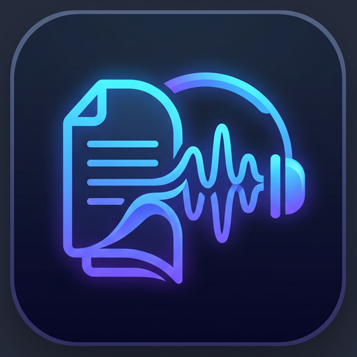

<p align="center"></p>

# 🎓 PDF → Audiolibro

**Convierte un PDF de apuntes en un audiolibro narrado como si te lo explicara un profesor.**

Script en Python que lee cada página del PDF (incluidas tablas, diagramas y fórmulas), genera con IA un guion de narración en prosa natural y lo convierte en audio con una voz neuronal en español. Funciona íntegramente con servicios gratuitos.

<p>
  
  
</p>

---

## ¿Por qué?

Escuchar apuntes leídos tal cual por un sintetizador de voz no sirve de mucho: las tablas se convierten en números sueltos, los diagramas desaparecen y las listas suenan robóticas. Este script le pide a un modelo multimodal que **explique** el contenido en lugar de leerlo:

- Las **tablas** se resumen verbalmente, con sus patrones y conclusiones.
- Los **diagramas e imágenes** se describen e interpretan.
- Las **fórmulas y el código** se explican primero de forma conceptual.
- El resultado es **prosa fluida** con transiciones naturales, pensada para escucharse sin ver nada, y termina con un resumen de los puntos clave.

## Cómo funciona

```
PDF ──▶ páginas como imágenes ──▶ Gemini (por bloques de 20 páginas) ──▶ guion .txt ──▶ edge-tts / Gemini TTS ──▶ audiolibro
         (PyMuPDF)                  narración tipo "profesor"                            voz neuronal              .mp3 / .wav
```

1. **Extracción**: cada página se renderiza como imagen con PyMuPDF. Así el modelo ve las tablas y los diagramas tal y como aparecen, sin depender de la extracción de texto.
2. **Narración**: las páginas se envían a Gemini en bloques de hasta 20. A cada bloque se le indica en qué parte del documento está, para que la narración sea continua y no se repita.
3. **Guion**: las narraciones se unen y se guardan en un `.txt`, por si quieres revisarlo o reutilizarlo.
4. **Audio**: el guion se convierte en MP3 con [edge-tts](https://github.com/rany2/edge-tts). Si edge-tts falla, el script pasa automáticamente a la voz de **Gemini TTS** (WAV), así que no se pierde el trabajo.

Incluye reintentos automáticos ante errores temporales (como el límite de peticiones del plan gratuito) y avisa si alguna respuesta se corta por longitud.

## Instalación

Requisitos: **Python 3.10** o superior.

```bash
git clone https://github.com/davilex7/pdf-to-audiobook.git
cd pdf-to-audiobook
pip install -r requirements.txt
```

Después, configura tu clave de Gemini. Es gratuita y no necesita tarjeta: consíguela en [Google AI Studio](https://aistudio.google.com/apikey).

```bash
cp .env.example .env
# Edita .env y pon tu clave: GEMINI_API_KEY=...
```

El archivo `.env` está en el `.gitignore`, así que tu clave nunca se sube al repositorio.

## Uso

```bash
# Uso básico: genera tema1_narracion.txt y tema1_audio.mp3 junto al PDF
python pdf_to_audio.py tema1.pdf

# Elegir voz y archivo de salida
python pdf_to_audio.py tema1.pdf --voz elvira --output audios/tema1.mp3

# Solo generar el guion, sin audio
python pdf_to_audio.py tema1.pdf --solo-texto

# Reutilizar el guion ya generado y crear solo el audio (no gasta otra llamada de narración)
python pdf_to_audio.py tema1.pdf --desde-texto

# Usar directamente la voz de Gemini
python pdf_to_audio.py tema1.pdf --tts gemini --voz Kore

# Usar otro modelo de Gemini
python pdf_to_audio.py tema1.pdf --modelo gemini-2.5-flash
```

| Opción | Descripción |
|---|---|
| `--voz` | Con edge-tts: `alvaro` (por defecto), `elvira`, `jorge`, `dalia` o cualquier ID de voz de edge-tts. Con Gemini: el nombre de una [voz de Gemini](https://ai.google.dev/gemini-api/docs/speech-generation) (por defecto, `Charon`) |
| `--tts` | Motor de voz: `edge` (MP3, por defecto) o `gemini` (WAV) |
| `--output` | Ruta del archivo de audio de salida |
| `--solo-texto` | Genera solo el guion, sin convertirlo a audio |
| `--desde-texto` | Reutiliza el guion ya generado (`<pdf>_narracion.txt`) y solo crea el audio |
| `--modelo` | Modelo de Gemini (también configurable con `GEMINI_MODEL` en el `.env`) |
| `--api-key` | Clave de Gemini, como alternativa al `.env` |

### Voces predefinidas de edge-tts

| Nombre | Voz | Descripción |
|---|---|---|
| `alvaro` | `es-ES-AlvaroNeural` | Hombre, España |
| `elvira` | `es-ES-ElviraNeural` | Mujer, España |
| `jorge` | `es-MX-JorgeNeural` | Hombre, México |
| `dalia` | `es-MX-DaliaNeural` | Mujer, México |

## Limitaciones

- El plan gratuito de Gemini tiene límites diarios y por minuto. Con PDFs muy largos puede tocar esperar: el script reintenta automáticamente ante errores de límite.
- edge-tts usa un servicio no oficial de Microsoft Edge y a veces deja de funcionar temporalmente (por ejemplo, con un error 403). En ese caso el script usa Gemini TTS automáticamente, o puedes elegirlo con `--tts gemini`.
- Gemini TTS tiene límites diarios más bajos que el modelo de texto en el plan gratuito, y genera WAV, que ocupa más que un MP3.
- La calidad de la narración depende de lo legible que sea el PDF. Los escaneos de mala calidad dan peores resultados.

---

<p align="center">Hecho por <a href="https://github.com/davilex7">David González</a></p>
